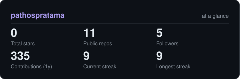
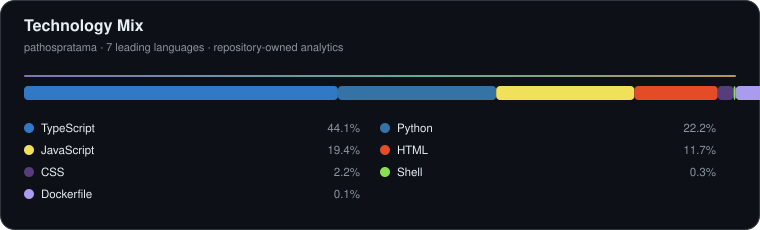

   

  <!-- ─── BANNER (foto kamu, TIDAK diubah) ─── -->
  <picture>
    <source media="(prefers-color-scheme: dark)" srcset="assets/banner-dark.v9.svg">
    <source media="(prefers-color-scheme: light)" srcset="assets/banner-light.v9.svg">
    
  </picture>

    

  <!-- ─── TYPING TAGLINE ─── -->
  

  <table>
    <tr>
      <th>Technology Radar · Radar Teknologi</th>
    </tr>
    <tr>
      <td align="center">
        <picture>
          <source media="(prefers-color-scheme: dark)" srcset="assets/radar-langs-dark.svg">
          <source media="(prefers-color-scheme: light)" srcset="assets/radar-langs-light.svg">
          
        </picture>
      </td>
    </tr>
  </table>

 

<!-- ═══════════════ STATS + METRICS ═══════════════ -->

  <code>&gt; fetch --stats --metrics --user=@pathospratama</code>
    

  <picture>
    <source media="(prefers-color-scheme: dark)" srcset="assets/card-stats-dark.svg">
    <source media="(prefers-color-scheme: light)" srcset="assets/card-stats-light.svg">
    
  </picture>
    
  

 

<!-- ═══════════════ ASCII DIVIDER ═══════════════ -->

  <code>──────[ ■ ]────── SYSTEM BREACH DETECTED ──────[ ■ ]──────</code>

 

<!-- ═══════════════ SNAKE ═══════════════ -->

  <code>&gt; tail -f /var/log/contributions.log</code>
    
  <picture>
    <source media="(prefers-color-scheme: dark)" srcset="https://raw.githubusercontent.com/pathospratama/pathospratama/output/github-contribution-snake-dark.svg">
    <source media="(prefers-color-scheme: light)" srcset="https://raw.githubusercontent.com/pathospratama/pathospratama/output/github-contribution-snake-light.svg">
    
  </picture>

 

<!-- ═══════════════ FOOTER ═══════════════ -->

  <code>[ connection_terminated ]</code>
   
  <code>$ exit 0 · built with code, curiosity &amp; persistence</code>
    
  Dibangun dengan code, rasa ingin tahu &amp; kegigihan — <b>@pathospratama</b>
    
  

